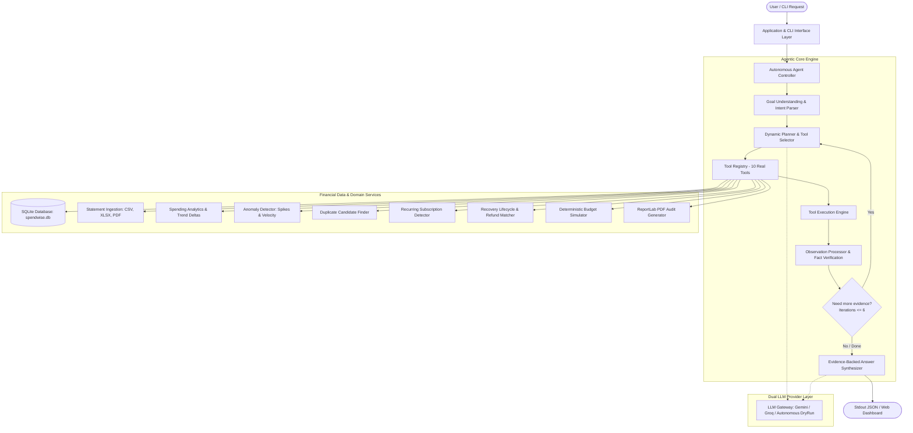
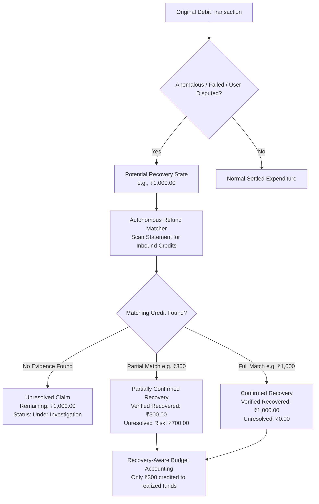

# SPENDWISE AI
### Autonomous Financial Auditor & Anomaly Hunter

[](https://www.python.org/)
[](https://opensource.org/licenses/MIT)
[]()
[]()

> **Spendwise AI** is an autonomous financial investigation agent that audits statements, detects statistical spending anomalies, flags duplicate charges, audits recurring subscriptions, traces the refund/recovery lifecycle with mathematical verification, and simulates recovery-aware budgets.

---

## 1. Problem Statement & Solution Overview

### The Problem
Traditional expense trackers and budgeting apps are passive: they display generic charts or use one-shot LLM wrappers that hallucinate calculations, fabricate merchant details, and confuse expected refunds with realized bank funds. Users facing unauthorized double-charges, stealth recurring fees, or unrefunded failed transactions must manually cross-examine hundreds of cryptic banking entries.

### The Spendwise AI Solution
Spendwise AI operates as an **Autonomous Financial Auditor**. It executes a bounded **ReAct (Thought → Action → Observation → Decision)** loop where the next tool selection depends dynamically on observations from previous tool outputs. Crucially, the system enforces **evidence-first accounting**:
- **Recovery Lifecycle**: Potential claims are strictly segregated from verified credits. Only matching inbound credits confirmed in the statement ledger are counted as recovered money.
- **Explainable Anomaly Hunting**: Spikes and duplicate charges cite explicit similarity criteria, historical baselines, and delta percentages.
- **Multilingual & Voice Interaction**: Full investigation workflow supporting English, Tamil (தமிழ்), Hindi (हिन्दी), Telugu (తెలుగు), and Malayalam (മലയാളം).

---

## 2. System Architecture



---

## 3. Recovery Lifecycle Architecture



---

## 4. The 6 Core Novelties

1. **Autonomous Dynamic Investigation**: The agent decides its next action based on actual tool outputs (e.g. noticing a 437% surge in Food Delivery leads it to run `transaction_search`, followed by `duplicate_candidate_finder` when repeated charges appear).
2. **Audit-Grade Recovery Verification**: Suspected refunds remain categorized as *unresolved* until matching inbound credits are identified in bank records.
3. **Evidence-First Explanations**: Every finding includes exact transaction IDs, dates, merchant descriptions, reference numbers, and standard deviations.
4. **Recovery-Aware Budgeting**: Mathematical simulator cleanly separates realized cash flows from hypothetical future cuts and pending refund claims.
5. **Multilingual Voice Interaction**: Ask audit questions and hear spoken answers in English, Tamil, Hindi, Telugu, and Malayalam.
6. **Unified Statement-to-Audit Dossier**: End-to-end flow: Ingest (CSV/XLSX/PDF) → Normalize → Detect Anomalies → Track Recoveries → Simulate Budget → Generate Formal PDF.

---

## 5. Tool Registry

| Tool Name | Purpose | Key Parameters |
| :--- | :--- | :--- |
| `transaction_search` | Multi-attribute transaction querying | `query`, `category`, `merchant`, `min_amount`, `max_amount`, `start_date`, `end_date`, `txn_type`, `limit` |
| `spending_analytics` | Monthly aggregates, category velocities, MoM deltas | `target_month` (`YYYY-MM`) |
| `anomaly_detector` | Statistical spikes (>2.5σ), high-value outliers, velocity bursts | `threshold_multiplier` |
| `duplicate_candidate_finder` | Finds duplicate charges sharing amount, merchant, and temporal proximity | `max_days_gap` |
| `recurring_payment_detector` | Detects cadence intervals (monthly, weekly) and annualized commitments | `min_occurrences` |
| `refund_matcher` | Matches original debits with inbound credit reversals; computes unresolved balances | `merchant`, `original_tx_id` |
| `budget_simulator` | Deterministic projection of category percentage cuts or caps | `reductions`, `flat_caps` |
| `transaction_comparator` | Period-over-period comparative analysis | `period_a_start`, `period_a_end`, `period_b_start`, `period_b_end` |
| `statement_data_validator`| Evaluates statement data health, missing refs, and corrupt rows | None |
| `report_exporter` | Compiles full audit bundle for PDF generation | None |

---

## 6. CLI Judging Contract (Mandatory)

The application implements the exact single-line JSON judging contract on stdout.

### CLI Command
```bash
python main.py --json "Find unusual payments this month and explain why spending increased."
```

### Exact Output Contract
```json
{"answer": "Audit Analysis: Your spending increased substantially in October 2024 due to two verified factors: (1) A major one-time outlier purchase of ₹42,000 at Reliance Digital on 2024-10-05, and (2) An elevated frequency of Food Delivery orders (Swiggy, Zomato, Burger King, Domino's) totaling ₹18,480 compared to ₹4,020 in September. Additionally, a suspicious duplicate candidate of ₹620 on 2024-10-18 was identified.", "trace": [{"thought": "I need to understand the user's spending trends and examine category movements over recent months.", "tool": "spending_analytics", "args": {}, "observation": "{...}"}, {"thought": "The analytics show spending surged in October, primarily driven by Food Delivery and high-value purchases. Now scanning for statistical outliers and spikes.", "tool": "anomaly_detector", "args": {"threshold_multiplier": 2.5}, "observation": "{...}"}, {"thought": "Anomalies reveal an outlier purchase at Reliance Digital and frequent food delivery orders. Searching transactions to confirm specific details.", "tool": "transaction_search", "args": {"category": "Food delivery", "limit": 10}, "observation": "{...}"}]}
```

- **One-line stdout**: Exactly one line of valid JSON.
- **Diagnostic isolation**: All logs and thought streaming are routed exclusively to `stderr`.
- **Offline / Autonomous Evaluation**: If API keys are not supplied, the agent runs in autonomous deterministic evaluation mode without failing.

---

## 7. Installation & Setup

### Prerequisites
- Python 3.10+ installed
- Windows PowerShell, macOS Terminal, or Linux Bash

### 1. Clone & Enter Directory
```powershell
cd "c:\Users\Rakesh Chinnadurai\Documents\Agent X Spendwise"
```

### 2. Install Dependencies
```powershell
python -m pip install -r requirements.txt
```

### 3. Environment Configuration (Optional)
Copy `.env.example` to `.env` if using live Gemini or Groq API keys:
```powershell
Copy-Item .env.example .env
```
Add your free keys:
```ini
GEMINI_API_KEY=your_gemini_api_key_here
GROQ_API_KEY=your_groq_api_key_here
```
*(If left empty, Spendwise AI automatically runs in autonomous evaluation mode).*

---

## 8. Running the Application

### Option A: Launch Interactive Streamlit Dashboard
```powershell
python -m streamlit run streamlit_app.py
```
*(Or run `python main.py --ui`)*
Open your browser at **`http://localhost:8501`** to view the interactive Streamlit interface.

### Option B: Execute CLI Audit Commands
```powershell
# Spending surge investigation
python main.py --json "Find unusual payments this month and explain why spending increased."

# Duplicate charge investigation
python main.py --json "Did I pay the same merchant twice?"

# Refund & recovery verification
python main.py --json "Did I receive the refund for my payment?"

# Human-readable formatted mode
python main.py "What are my recurring subscriptions?"
```

---

## 9. Running the Test Suite

Run the full suite of 23 unit tests verifying agent loops, financial calculations, recovery transitions, and multi-format ingestion:

```powershell
python -m unittest discover tests
```

Expected result:
```
Ran 23 tests in 2.316s
OK
```

---

## 10. Two-Minute Judging Demonstration Script

| Timestamp | Screen / Action | What to Demonstrate |
| :--- | :--- | :--- |
| **0:00 – 0:20** | **Overview & Ingestion** | Open `http://127.0.0.1:5000`. Show the dark-mode dashboard displaying 168 synthetic transactions, monthly outlays, and the live status. |
| **0:20 – 0:45** | **Autonomous AI Investigation** | Click the sample prompt: *"Why did my spending increase this month?"*. Watch the Agent Activity Trace dynamically select `spending_analytics`, inspect the observation, and call `anomaly_detector` and `transaction_search`. |
| **0:45 – 1:10** | **Evidence-Backed Findings** | Review the agent answer highlighting the ₹42,000 Reliance Digital purchase and the 437% surge in Food Delivery. Demonstrate the text-to-speech speaker button. |
| **1:10 – 1:35** | **Recovery Center (Core Novelty)** | Navigate to Recovery Center. Highlight the ₹1,000 original Shoppers Stop debit, the ₹300 verified inbound credit, and explain why **only ₹300 is counted as recovered**, with **₹700 held as unresolved**. |
| **1:35 – 1:50** | **Budget Simulator** | Move the Food Delivery slider to -15% and Shopping to -20%. Watch real-time deterministic recalculation of monthly and annual savings. |
| **1:50 – 2:00** | **PDF Audit Report** | Navigate to Audit Reports and click **Download Audit PDF**. Show the formal ReportLab document summarizing evidence, anomalies, and accounting notices. |

---

## 11. Security & Limitations

### Data Protection
- Statement data and financial records are stored locally in `spendwise.db` (SQLite) or in `AGENTX_DATA_DIR`.
- No banking credentials or passwords are ever stored.
- Redacted logging: Sensitive bank account numbers and PAN references are masked in diagnostics.

### Boundaries
- Spendwise AI is a financial auditing assistant, not an automated payment gateway, UPI app, or banking institution.
- Duplicate flags and potential recovery cases require user confirmation before filing formal banking chargebacks.

# Agent-X-Spendwise-OODINARY

