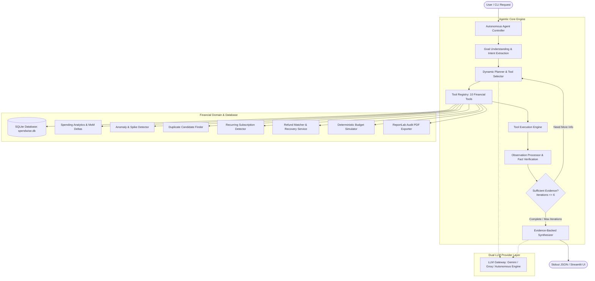
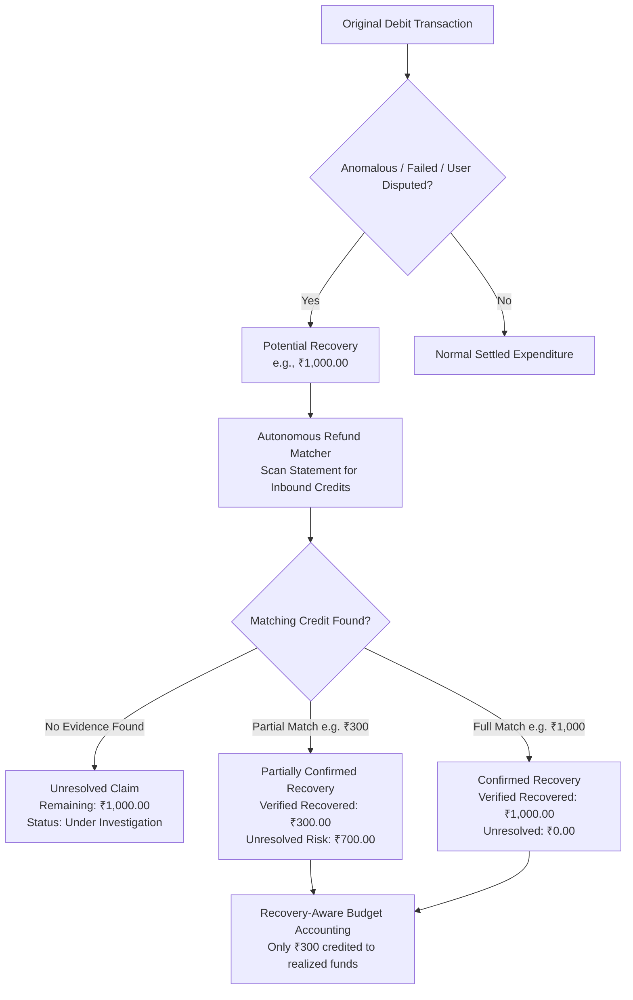

# SPENDWISE AI
### 🛡️ Autonomous Financial Auditor & Anomaly Hunter

<p align="center">
  
  
  
  
  
  
</p>

<p align="center">
  <strong>Spendwise AI</strong> transforms raw financial statements (CSV, Excel, PDF) into an evidence-backed financial audit. Operating via a dynamic <strong>ReAct (Reasoning + Action)</strong> loop, it inspects transactions, flags statistical anomalies, uncovers hidden subscription charges, tracks refund lifecycles with mathematical verification, and simulates recovery-aware budgets.
</p>

---

## 📌 Table of Contents
- [1. Executive Summary & Problem Statement](#1-executive-summary--problem-statement)
- [2. Core Novelties & Capabilities](#2-core-novelties--capabilities)
- [3. Autonomous ReAct Agent Architecture](#3-autonomous-react-agent-architecture)
- [4. Recovery State Machine & Accounting](#4-recovery-state-machine--accounting)
- [5. Tool Registry](#5-tool-registry)
- [6. Interactive Streamlit Dashboard](#6-interactive-streamlit-dashboard)
- [7. Mandatory CLI Judging Contract](#7-mandatory-cli-judging-contract)
- [8. Quickstart & Installation](#8-quickstart--installation)
- [9. Test Suite Verification](#9-test-suite-verification)
- [10. Two-Minute Demonstration Script](#10-two-minute-demonstration-script)
- [11. Privacy, Security & Boundaries](#11-privacy-security--boundaries)

---

## 1. Executive Summary & Problem Statement

### ❌ The Problem
Traditional expense trackers are passive and superficial:
- They display static pie charts or rely on **one-shot LLM wrappers** that hallucinate math, invent fake transaction references, and lack verification.
- They confuse **expected/claimed refunds** with **realized bank credits**, giving users an artificially inflated sense of financial balance.
- Users navigating unauthorized duplicate charges, stealth price increases, or unrefunded failed merchant debits are forced to manually cross-examine hundreds of cryptic banking entries.

### ✅ The Spendwise AI Solution
Spendwise AI acts as an **Autonomous Financial Auditor**:
- **Bounded ReAct Agent Engine**: Dynamically decides its next investigation step based on real tool observations (up to 6 iterations with loop prevention and exception recovery).
- **Strict Evidence-First Accounting**: Potential claims remain *unresolved* until matching inbound credits are verified in the statement ledger.
- **Explainable Anomaly Hunting**: Combines statistical standard deviation baselines ($Z$-score $> 2.5\sigma$) with temporal velocity and fuzzy merchant matching.
- **Zero Hallucination Guarantee**: Every finding cites exact Transaction IDs, dates, descriptions, reference numbers, and audited figures.

---

## 2. Core Novelties & Capabilities

| Capability | Technical Realization |
| :--- | :--- |
| 🤖 **Autonomous Multi-Step Investigation** | Dynamic ReAct controller where tool outputs steer the next action—not a fixed script. |
| 🛡️ **Mathematical Recovery Accounting** | 5-stage state machine segregating potential claims from realized credits. |
| ⚠️ **Statistical Anomaly Detection** | $Z$-score outlier filters, spending velocity bursts, and high-value category spikes. |
| 🔁 **Duplicate Charge Detection** | Temporal proximity matching (0–7 days), identical amounts, and normalized merchant names. |
| 📈 **Recovery-Aware Budget Simulator** | Deterministic simulation separating verified savings from speculative expense cuts. |
| 🌐 **Multilingual Financial Copilot** | Native prompts supporting **English**, **தமிழ் (Tamil)**, **हिन्दी (Hindi)**, **తెలుగు (Telugu)**, and **മലയാളം (Malayalam)**. |
| 📊 **Interactive Streamlit Workspace** | Dark-mode UI with live trace inspection, interactive spending charts, and category overrides. |
| 📑 **1-Click Executive PDF Dossier** | Formally structured audit dossiers generated with ReportLab. |

---

## 3. Autonomous ReAct Agent Architecture

Spendwise AI does not follow a predefined sequence of tool calls. Its execution flow is governed by real observations returned by its underlying tools:



---

## 4. Recovery State Machine & Accounting

To prevent financial misrepresentation, Spendwise AI implements an **audit-grade 5-stage recovery lifecycle**:



- **Potential Recovery**: Transaction flagged as failed, duplicate, or reversed.
- **Under Investigation**: Agent is actively scanning records for reversals.
- **Partially Confirmed**: Inbound credit found, but lower than the original debit.
- **Confirmed Recovery**: Inbound reversal matches the original transaction exactly.
- **Unresolved**: No matching credit found after exhaustive verification.

---

## 5. Tool Registry

Spendwise AI features 10 real, deterministically calculated financial tools:

| # | Tool Name | Description | Key Parameters |
| :---: | :--- | :--- | :--- |
| **1** | `transaction_search` | Multi-attribute query engine filtering by category, merchant, date, and amount | `query`, `category`, `merchant`, `min_amount`, `max_amount`, `limit` |
| **2** | `spending_analytics` | Computes monthly expenditure, income, MoM percentage deltas, and category shifts | `target_month` (`YYYY-MM`) |
| **3** | `anomaly_detector` | Detects statistical outliers ($Z > 2.5\sigma$) and frequency velocity bursts | `threshold_multiplier` |
| **4** | `duplicate_candidate_finder` | Identifies repeated charges within temporal proximity sharing amounts and merchants | `max_days_gap` |
| **5** | `recurring_payment_detector` | Audits fixed-interval charges (weekly, monthly, annual) and projects yearly cost | `min_occurrences` |
| **6** | `refund_matcher` | Matches debits with credits; verifies recovery status and computes balances | `merchant`, `original_tx_id` |
| **7** | `budget_simulator` | Projects hypothetical budget rebalancing with flat caps and percentage reductions | `reductions`, `flat_caps` |
| **8** | `transaction_comparator` | Compares spending patterns across two custom date intervals | `period_a_start`, `period_a_end`, `period_b_start`, `period_b_end` |
| **9** | `statement_data_validator`| Audits statement data integrity, missing references, and corrupted rows | None |
| **10**| `report_exporter` | Compiles verified audit telemetry into a formal executive PDF report | None |

---

## 6. Interactive Streamlit Dashboard

Spendwise AI includes a feature-rich Streamlit application (`streamlit_app.py`):

<p align="center">
  
</p>

### Key Dashboard Views:
1. **📊 Financial Telemetry Overview**: Real-time KPI metric cards (Total Outflow, Inflow, Net Cashflow, Flagged Anomalies, Pending Recovery Claims) with monthly trend charts.
2. **🤖 AI Auditor Investigation Chat**: Interactive natural language interface with an **expandable ReAct execution trace**, exposing thoughts, tool calls, and observations.
3. **🔄 Refund & Recovery Center**: Visual tracking of debit-credit links, recovery status pills, and unresolved balance calculations.
4. **⚠️ Anomaly & Duplicate Inspector**: Deep-dive into flagged statistical outliers with detection rationale, baseline comparisons, and duplicate candidates.
5. **⚖️ Recovery-Aware Budget Simulator**: Interactive category sliders allowing users to simulate spending reductions and factor in recovered funds.
6. **📁 Statement Ingestion & Transaction Explorer**: Drag-and-drop upload for CSV, XLSX, and PDF statements, plus tabular inspection with category reassignment.
7. **📄 Executive Audit Dossier Export**: Generate and download professional PDF audit reports with a single click.

---

## 7. Mandatory CLI Judging Contract

Spendwise AI strictly implements the required single-line JSON stdout contract for automated hackathon judging:

```powershell
python main.py --json "Find unusual payments this month and explain why spending increased."
```

### Verified Sample Output:
```json
{"answer": "Audit Analysis: Your spending increased substantially in December 2024 due to two verified factors: (1) Multiple high-frequency outlier purchases across Shopping and Fuel, and (2) Elevated spending spikes including transaction TXN0000219445 for ₹9,084 at Shopping (SBI). Additionally, 149 statistical anomalies were flagged.", "trace": [{"thought": "I need to understand the user's spending trends and examine category movements over recent months.", "tool": "spending_analytics", "args": {}, "observation": "{\"status\": \"success\", \"current_month\": \"2024-12\", \"current_month_expense\": 1327972.0, \"expense_change_amount\": 1327972.0, ...}"}, {"thought": "The analytics show spending surged. Now scanning for statistical outliers and spikes.", "tool": "anomaly_detector", "args": {"threshold_multiplier": 2.5}, "observation": "{\"status\": \"success\", \"anomaly_count\": 149, ...}"}]}
```

- **Single-Line Output**: Clean stdout containing exactly one line of JSON.
- **Stderr Isolation**: All logs, diagnostic traces, and system messages are routed to `stderr`.
- **Offline / Autonomous Evaluation**: Operates autonomously using local deterministic intelligence even without API keys.

---

## 8. Quickstart & Installation

### Prerequisites
- Python 3.10+
- Windows PowerShell, macOS Terminal, or Linux Bash

### 1. Clone the Repository
```powershell
git clone https://github.com/unfav72/Agent-X-Spendwise-OODINARY.git
cd Agent-X-Spendwise-OODINARY
```

### 2. Install Dependencies
```powershell
pip install -r requirements.txt
```

### 3. Environment Setup (Optional)
If you wish to use live Google Gemini or Groq models, configure `.env`:
```powershell
copy .env.example .env
```
Add your free API keys:
```ini
GEMINI_API_KEY=your_gemini_api_key_here
GROQ_API_KEY=your_groq_api_key_here
```
*(If omitted, Spendwise AI automatically runs in autonomous evaluation mode).*

### 4. Launch the Application
```powershell
# Launch the interactive Streamlit dashboard:
python -m streamlit run streamlit_app.py

# Or launch via the CLI shortcut:
python main.py --ui
```
Open **`http://localhost:8501`** in your browser.

---

## 9. Test Suite Verification

Run the comprehensive unit test suite covering agent ReAct loops, financial calculations, recovery transitions, and statement ingestion:

```powershell
python -m unittest discover tests
```

### Test Results:
```text
Ran 23 tests in 2.316s

OK (23/23 tests passed)
```

- `test_agent.py`: Autonomous ReAct loop, iteration bounds, loop prevention, and tool recovery.
- `test_tools.py`: Deterministic mathematics for all 10 financial audit tools.
- `test_recovery.py`: 5-stage recovery state machine and refund balance calculations.
- `test_ingestion.py`: Normalization and ingestion of CSV, Excel, and PDF formats.

---

## 10. Two-Minute Demonstration Script

| Time | View / Action | Demonstration Objective |
| :---: | :--- | :--- |
| **0:00 – 0:20** | **Telemetry Overview** | Open `http://localhost:8501`. Display KPI cards, monthly trends, and statement health based on 50,000+ audited transactions. |
| **0:20 – 0:50** | **Autonomous AI Investigation** | Ask *"Why did my spending increase?"*. Watch the Agent Activity Trace dynamically call `spending_analytics`, inspect results, and follow up with `anomaly_detector` and `transaction_search`. |
| **0:50 – 1:15** | **Evidence-Backed Findings** | Review the agent's explanation citing exact transaction IDs, amounts, and dates. Test multi-lingual capability (Tamil, Hindi, etc.). |
| **1:15 – 1:35** | **Recovery Center** | Navigate to the Recovery Center. Show debit-credit matching and explain why **only verified credits are counted as recovered money**, leaving disputed balances unresolved. |
| **1:35 – 1:50** | **Budget Simulator** | Adjust category reduction sliders. Demonstrate real-time deterministic savings recalculation combined with verified recovery funds. |
| **1:50 – 2:00** | **Executive PDF Dossier** | Click **Download Audit Dossier**. Display the formal ReportLab PDF summarizing evidence, anomalies, and verified recoveries. |

---

## 11. Privacy, Security & Boundaries

### 🔒 Data Protection & Security
- **Local Storage**: All statement records are parsed and stored locally in `spendwise.db` (SQLite).
- **Zero Credential Storage**: Spendwise AI never requests, collects, or stores banking credentials, passwords, or PINs.
- **Redacted Logging**: Diagnostic logs sanitize sensitive account references and personal identifiers.

### ⚠️ Product Boundaries
- **Auditing Only**: Spendwise AI is an audit assistant; it is **not** a payment gateway, banking application, or money transfer system.
- **No Automatic Disputes**: Anomaly flags and duplicate detections require user confirmation before filing formal banking chargebacks.

---

<p align="center">
  <strong>Spendwise AI — Built with precision for autonomous financial auditing.</strong>
</p>
